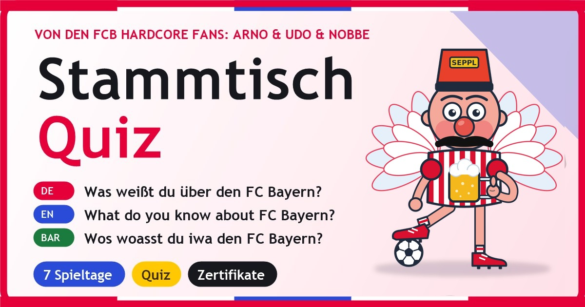

**⚽ Live ansehen: [https://nosz.github.io/schwaben-fcb-power](https://nosz.github.io/schwaben-fcb-power)**

# Schwaben FCB Power: Stammtisch-Quiz

**Von den FCB Hardcore Fans: Arno & Udo & Nobbe** (inoffizielles Fan-Projekt)

**Datei:** `index.html` (eine Datei, offline lauffähig, Version 1.4.1, Stand 14.10.2026). Einfach im Browser öffnen oder auf einem Webserver ablegen.

> **Veröffentlichung:** GitHub-Repository `schwaben-fcb-power` (Benutzer `nosz`), Adresse `https://nosz.github.io/schwaben-fcb-power/`. Alle Dateien der Liste unten ins Hauptverzeichnis des Repositories legen (ohne Unterordner), GitHub Pages auf den Hauptzweig (Branch) stellen. Bei anderer Adresse in `index.html` (canonical, og:url, og:image, twitter:image) und in dieser README anpassen.

## Inhalt
Fan-Quiz mit 7 Spieltagen, viel Humor, Zertifikaten und Personalisierung, in **Deutsch, Englisch und Bairisch** (Umschalter oben, wird gespeichert).

| Nr. | Spieltag | Fragen |
|---|---|---|
| 1 | Blitzstart: 1900 in 60 Sekunden | 2 |
| 2 | Die Meistermaschine | 2 |
| 3 | Legenden: Beckenbauer, Kahn & Co. | 4 |
| 4 | Europa: Sechs Sterne und ein Finale dahoam | 4 |
| 5 | Allianz Arena & Kurve: Zahlen zum Staunen | 4 |
| 6 | Spitznamen & Triple: Stern des Südens | 4 |
| 7 | Bossrunde: Elfmeterschießen | 5 |

- **Hinweis ganz oben:** In der Kopfzeile direkt unter "Stammtisch-Quiz" steht groß und fett: "von den FCB Hardcore Fans: Arno & Udo & Nobbe" (Deutsch, Englisch, Bairisch), ebenso auf jedem Zertifikat und in der Fußzeile.
- **Stammtisch-Spruch & Fakt:** Karte auf der Startseite mit 16 Sprüchen und Fakten (Gags von Arno, Udo & Nobbe plus belegte Zahlen aus den Quellen), Knopf "Noch einer!" zeigt den nächsten.
- **Startseite:** "Servus! Was weißt du über den FC Bayern?" mit zwei Wegen ("Ich bin neu im Stadion" / "Ich bin schon ewig Fan"). Name optional, nur lokal gespeichert, steckt in Begrüßung, Quiz, Ergebnis und Zertifikat.
- **Spielmechanik:** 10 Tore je richtiger Antwort, 1 bis 3 Sterne je Spieltag, 5 Ränge von "Bankdrücker" bis "Vereinslegende", Konfetti, Hell- und Dunkelmodus.
- **Zertifikate:** je Spieltag ein "Stammtisch-Zertifikat", zum Abschluss das "Meisterschalen-Zertifikat" (PNG speichern oder drucken). Unterschrieben "Arno, Udo & Nobbe (inoffiziell)".
- **PWA:** installierbar, läuft offline, Update-Hinweis. Dateien (alle ins Hauptverzeichnis): `index.html`, `manifest.webmanifest`, `sw.js`, `icon-192.png`, `icon-512.png`, `icon-maskable-512.png`, `favicon.png`, `favicon.svg`, `apple-touch-icon.png`, `fcbayern_vorschau.jpg`. Bei jeder neuen Version `VERSION` in `index.html` **und** `sw.js` gemeinsam erhöhen.

## Tests (14.10.2026, lokaler Testserver)
Daten und Texte (alle in 3 Sprachen, 93 Oberflächentexte, 16 Sprüche), 7 Spieltage x 3 Sprachen komplett durchgespielt, Namensfrage und Personalisierung, 168 Urkunden (7 Namen, 3 Sprachen, 8 Urkunden) im Rand, PWA (Manifest, Icons, Service Worker, Offline bei gestopptem Server, Fortschritt nach Neuladen), UX-Suite U1 bis U10 auf dem Handy (375 px) hell und dunkel. Nicht getestet: echtes Gerät, GitHub Pages selbst, fcbayern.com-Links.

## Marke und Look
Farben nach dem Auftritt von fcbayern.com/de (Rot, Weiß, Dunkel, zarter Rosa-Blau-Verlauf), aus einem Screenshot geschätzt, nicht aus dem Quelltext der Seite. Es werden **kein Vereinswappen, keine Logos, keine Spielerfotos und keine kopierten Texte** verwendet. Das Logo ist ein selbst gezeichneter Pixel-Fanschal. Die Seite ist ein inoffizielles Fan-Projekt ohne Verbindung zum FC Bayern München.

## Quellen (Stand Frühjahr 2026, abgerufen 14.10.2026)
- Wikipedia (DE): https://de.wikipedia.org/wiki/FC_Bayern_M%C3%BCnchen
- Wikipedia (EN): https://en.wikipedia.org/wiki/FC_Bayern_Munich

## Bekannte Grenzen
- Wikipedia ist eine Sekundärquelle. Zahlen (Titel, Mitglieder, Umsatz) ändern sich; offizielle Werte gibt es beim Verein.
- Die Bayern-Texte (Bairisch) sind spielerisch gemeint und keine Rechtschreibnorm; Dialekt-Profis dürfen korrigieren. Die englischen Texte sollten Muttersprachler gegenlesen.
- `fcbayern.com` war beim Test von der Entwicklungsumgebung aus nicht erreichbar (Zeitüberschreitung); die Links dorthin sind nicht automatisch geprüft.
- Vor einer öffentlichen Veröffentlichung Marken- und Stil-Anlehnung mit Management/Legal klären.

## Änderungsprotokoll
- 1.4.1 (15.10.2026): Der Link „Mehr vom Verein entdecken“ unter Ergebnis und Zertifikat ist jetzt eine Karte mit Fußball-Symbol, Titel, Adresse und Pfeil (statt eines unterstrichenen Textlinks).
- 1.4.0 (15.10.2026): Benutzerführung überarbeitet: Ablaufleiste „1 Lesen · 2 Quiz · 3 Zertifikat“ mit aktuellem Schritt in Lektion, Namensabfrage, Quiz, Ergebnis und Zertifikat; die Zurück-Leiste nennt den Standort („Lektion 3 von 7“). Wer eine Lektion schon geschafft hat, sieht in der Lektion oben eine Karte „Geschafft! Dein Zertifikat ist fertig“ mit den Knöpfen „Zertifikat ansehen“ und „Nochmal spielen“ (auch unten fest); auf der Startseite haben geschaffte Kacheln einen Knopf „Zertifikat ansehen“, und „Deine Zertifikate“ steht jetzt direkt über den Lektionen. Das Zertifikat führt zur nächsten Lektion und zu „Alle Zertifikate“.
- 1.3.0 (15.10.2026): Fußbereich neu gestaltet: Hinweise (inoffiziell, Übersetzung) in einer Karte mit Info-Symbol, Version als Chip darunter. Der Link zur offiziellen Seite im Fuß entfällt, weil er schon im Bereich Mehr vom Verein steht.
- 1.2.1 (15.10.2026): Manifest: eigene App-ID (/schwaben-fcb-power/) statt "./". Vorher hatten alle Apps auf nosz.github.io dieselbe ID (die Ursprungsadresse) und Android meldete eine App als bereits installiert, obwohl eine andere gemeint war.
- 1.2.0 (15.10.2026): Klick auf Name ändern oder Name eintragen scrollt das Namensfeld automatisch in den sichtbaren Bereich und setzt den Cursor hinein.
- 1.1.0 (15.10.2026): Teilen-Symbol in der Kopfzeile (Teilen-Menü des Geräts, sonst Fenster mit WhatsApp, E-Mail, Link kopieren); „Name ändern“ als Button unter Rang, Münzen und Sternen; „Lieber anonym bleiben“ als Button; Klick auf Logo oder Titel bringt nach oben bzw. zur Startseite; Karten unter „Mehr vom Verein“ gleich groß ohne überlaufende Texte.
- 1.0.2 (14.10.2026): Fix: Wer den Namen leer oder nur mit Leerzeichen bestätigt, kann ihn später über „Name eintragen“ auf der Startseite nachholen.
- 1.0.1 (14.10.2026): Hinweis "von den FCB Hardcore Fans: Arno & Udo & Nobbe" in der Kopfzeile unter dem Titel (größer, 15 px fett), dunklen Extra-Banner entfernt.
- 1.0.0 (14.10.2026): Erstfassung (Technik der Nintendo-Quest-Seite, Inhalte neu), Repository `schwaben-fcb-power`.